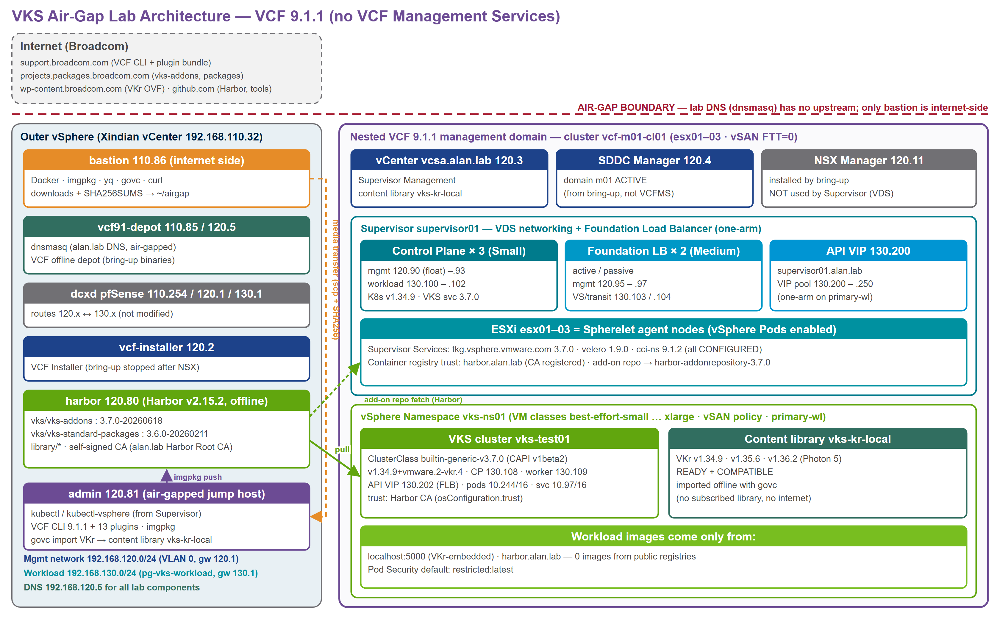
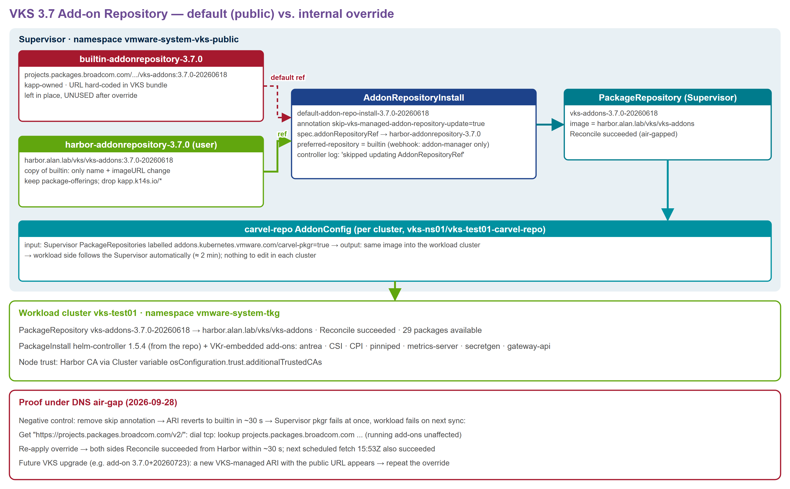

# VKS Air-Gapped on VCF 9.1.1 — without VCF Management Services

在 VCF 9.1.1 管理網域上，**不部署 VCF Management Services（VCFMS）**，建置可在隔離網路運作的 vSphere Kubernetes Service（VKS）。
Supervisor 採 **VDS + Foundation Load Balancer**，registry 用**外部 Harbor（單台 Linux）**，並在 DNS 層級切斷外網的情況下驗證。



## 文件

| 檔案 | 內容 |
|---|---|
| [VKS-AirGap-VCF911-Installation-Procedures.docx](docs/VKS-AirGap-VCF911-Installation-Procedures.docx)（[PDF](docs/VKS-AirGap-VCF911-Installation-Procedures.pdf)） | 安裝與組態程序（33 頁）：架構、前置需求、程序 4.1–4.13、air-gap 驗證、疑難排解 |
| [VKS-AirGap-VCF911-NoVCFMS.pptx](docs/VKS-AirGap-VCF911-NoVCFMS.pptx) | 技術簡報（25 頁，含中文講者備註） |
| [docs/work/diagrams/](docs/work/diagrams) | 架構圖 d1–d4（PNG / SVG） |

### UI step-by-step（另一套 lab m05 / m06，全部 vSphere Client UI 截圖）

| Supervisor 網路 | 一般 | air-gap |
|---|---|---|
| VPC（VLAN-backed VPC，NSX + VNA） | [ui-step-by-step/vpc](ui-step-by-step/vpc/README.md) | [ui-step-by-step/vpc-airgap](ui-step-by-step/vpc-airgap/README.md) |
| 非 VPC（VDS + Foundation LB） | [ui-step-by-step/vds-flb](ui-step-by-step/vds-flb/README.md) | [ui-step-by-step/vds-flb-airgap](ui-step-by-step/vds-flb-airgap/README.md) |
| **VPC air-gap + 不部署 VCFMS（m06）** | — | [ui-step-by-step/vpc-airgap-novcfms](ui-step-by-step/vpc-airgap-novcfms/README.md) |

每份都附 docx。air-gap 版用 Supervisor 的 **Container Registries**（UI）信任 Harbor CA、用 Local Content Library 匯入 VKr；沒有涵蓋 addon 套件庫改指。m05 有部署 VCFMS；**m06 從 VCF Installer UI 精靈 bring-up、在 VSP 開始時中止（不部署 VCFMS）**，證明 VPC Supervisor + VKS 不依賴 VCFMS。和本文件的差異見 [ui-step-by-step/README.md](ui-step-by-step/README.md)。

## 流程摘要

1. **VCF bring-up 跑到 NSX 就中止**：spec 必須保留 `vspClusterSpec`（否則 validation 拒絕），在 subtask #272
   `Deploy VCF Management Services via SDDC Manager` 開始時停止 installer 的 `domainmanager`、重啟 SDDC Manager 的 `domainmanager`。
2. **Supervisor = VDS + Foundation LB（one-arm）**：管理網 120.x，workload 網 130.x（必須不同 subnet）。
3. **nested lab only**：silence vSAN 測試 `nvmeonhcl`，否則 vLCM 健康檢查擋住 Spherelet。
4. **air-gap 素材**：bastion 下載（Docker debs、Harbor offline installer、VKr、`vks-addons` bundle、VCF CLI + plugins）→ SHA256 → admin 匯入。
5. **Harbor 離線安裝**（自簽 CA）→ 登錄 Supervisor → VKr content library → Namespace → VKS cluster（CA 透過 `osConfiguration.trust` 注入）。
6. **addon 套件庫改指 Harbor**：VKS 3.7 的 builtin AddonRepository 寫死 `projects.packages.broadcom.com`。
   官方做法：新建乾淨的 AddonRepository + ARI 加 `addons.kubernetes.vmware.com/skip-vks-managed-addon-repository-update=true` + 改 `addonRepositoryRef`。
7. **驗證**：DNS 切斷下做反向對照（移除 skip → 兩端失敗；改回 → 恢復），最終 0 個外部 image。



## 目錄結構

```
docs/                 docx / pdf / pptx
docs/work/            文件與架構圖產生器（build_docx.py、build_pptx.py、diagrams.py、clone-slide.py）
scripts/              實作用腳本（bring-up 中止、Supervisor、Harbor、匯入、addon 改指、驗證）
manifests/            vks-test01 Cluster（CAPI v1beta2、ClusterClass builtin-generic-v3.7.0）
certs/harbor-ca.crt   lab Harbor 根憑證（公開憑證）
ui-step-by-step/      UI 逐步截圖文件（m05：vpc / vpc-airgap / vds-flb / vds-flb-airgap；m06：vpc-airgap-novcfms；各含 docx）
```

## 使用腳本

腳本不含任何密碼，執行前請設定環境變數：

```bash
export LAB_PASSWORD='...'          # nested vCenter / ESXi / SDDC Manager / Harbor / ubuntu
export OUTER_VC_PASSWORD='...'     # 外層 vCenter（deploy_helper_vms.py、deploy_nested.ps1）
export SSH_PUBKEY='ssh-ed25519 ...'  # 選用：helper VM 的 authorized key
```

`scripts/*.json` 內的密碼欄位為 `<LAB_PASSWORD>` 佔位字。IP / FQDN 為 alan.lab 實驗環境值，請依環境修改。

## 重新產生文件

```bash
cd docs/work
python diagrams.py                   # 架構圖（需要 Chrome headless）
python build_pptx.py                 # 需要 base.pptx = BroadcomPPT 的 TECH_TUESDAY_Whats_New_with_vSAN_in_VCF_9_1.pptx
python build_docx.py kit-lld.docx    # kit-lld.docx = BroadcomPPT/vcf-delivery-examples/VCF_LowLevelDesign.docx；不帶參數則用預設樣式
```

## 限制

- 驗證為 **DNS 層級** air-gap（直接用 IP 仍可出網）；正式環境請搭配防火牆阻擋。
- VKS 升級後會產生指向公開網址的新 AddonRepositoryInstall，需重做 addon 改指。
- 本案是外部 registry 的文件化 override；VCF 9.1 的 air-gap 參考架構假設有 VCF Software Depot。
